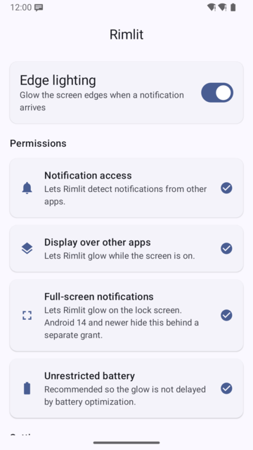
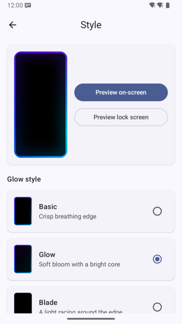
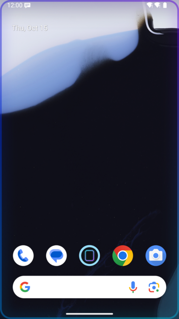
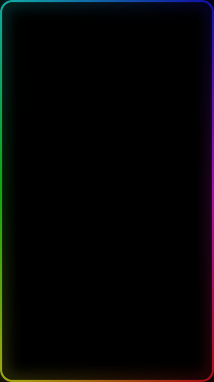

# Rimlit

Rimlit lights up the edges of your screen when a notification arrives — Samsung-style edge lighting for any Android phone. It is free, open source, has no ads, and never touches the network.

| Home | Style | On screen | Screen off |
|---|---|---|---|
|  |  |  |  |

## Features

- **Works everywhere:** while you use the phone the glow is drawn over whatever is on screen; when the screen is off it wakes into a black, always-on-display style glow. With the recommended accessibility glow it also frames the lock screen itself.
- **Three styles:** a crisp breathing edge, a soft bloom with a bright core, or a blade of light racing around the screen.
- **Your colors:** one to three colors picked automatically from the notifying app's icon (or from the notification's picture, such as the sender's photo), a single custom color, a gradient of up to five colors, or a flowing rainbow. Any app can get its own palette.
- **Tune it:** thickness, glow width, speed, brightness (with its own setting for the screen-off glow if you like) and duration, with a live preview that updates as you drag.
- **Easy on you and the battery:** with Remove animations turned on, the glow holds still instead of pulsing or racing; with battery saver (the system's, or always) it draws at most 30 frames a second.
- **Fits your screen:** follows your display's real rounded corners, and can ring the camera cutout instead of the whole edge, or as well as it.
- **When it glows:** choose separately whether it glows with the screen off, above the lock screen, and while you use the phone, and set daily quiet hours (for every glow, or only the one that wakes the screen). Turning edge lighting off, or excluding an app, also ends a glow that is showing.
- **Double tap to open:** double tap the screen-off glow to unlock and open the notification, just as tapping it in the shade would; a single tap still dismisses the glow. It can be turned off.
- **Respectful:** honors Do Not Disturb, skips silent and low-priority notifications, and never covers incoming-call or alarm screens. Any app can be excluded.

## Install

Rimlit needs Android 10 or newer. Download the latest APK from [Releases](https://github.com/adityam23/rimlit/releases) and open it on your phone (you may need to allow installs from your browser or file manager).

Open Rimlit, turn on **Edge lighting**, and grant the permissions listed on the home screen:

- **Notification access** — to notice when notifications arrive. Rimlit only looks at which app posted it and its colors; nothing is stored or sent anywhere.
- **Display over other apps** — to draw the glow while you use the phone.
- **Notifications** — Rimlit wakes the screen with a silent notification of its own, so keep its notifications and its "Edge lighting" category on.
- **Full-screen notifications** — to wake the screen and show the glow when it is off.
- **Accessibility glow** (recommended) — an accessibility service, **Rimlit glow**, that draws the glow over your apps and above the lock screen. It only owns the glow window: it receives no accessibility events and cannot read or control anything on screen. On Android 13 and newer you may first need to tap **Allow restricted settings** in Rimlit's App info menu.
- **Unrestricted battery** (recommended) — so the system doesn't delay the glow. Some phones (Xiaomi, Huawei, OnePlus) also need autostart enabled in their own battery settings.

### Why does Android say "Rimlit is displaying over other apps"?

Without the accessibility glow, Rimlit draws on-screen glows with **Display over other apps**, and Android posts that notice for as long as such a window is up. Turning on **Rimlit glow** in Accessibility settings avoids it: the glow is then drawn in an accessibility window, which Android doesn't announce. The home screen tells you when the notice will appear, including when the service is turned on but isn't running (turn it off and on again). On recent Android versions the notice itself can't be turned off; it is already a silent, minimised notification.

## Privacy

Rimlit has no internet permission at all, so it cannot send anything off your device. There are no analytics, ads or accounts. Settings stay on the phone and are excluded from cloud backups.

## Build from source

You need JDK 25, Gradle 9.8 and the Android SDK (platform 36). The project intentionally has no Gradle wrapper, so use your installed `gradle`:

```bash
gradle :app:testDebugUnitTest :app:assembleDebug :app:lintDebug :app:detektMain
adb install -r app/build/outputs/apk/debug/app-debug.apk
```

## Releases

Grab signed APKs from [GitHub Releases](https://github.com/adityam23/rimlit/releases).

## License

Rimlit is licensed under the [GNU General Public License v3.0](LICENSE).
