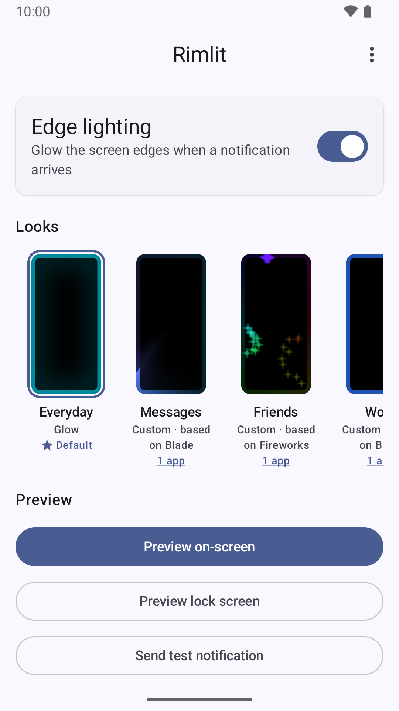
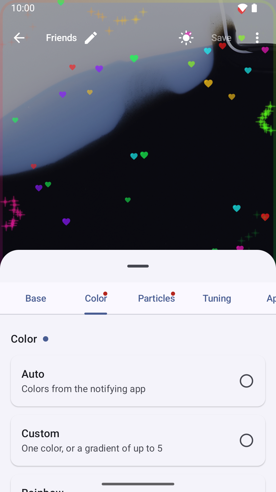
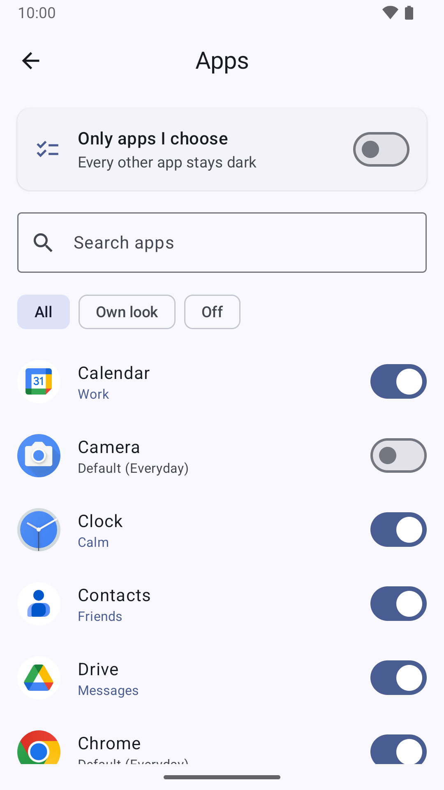
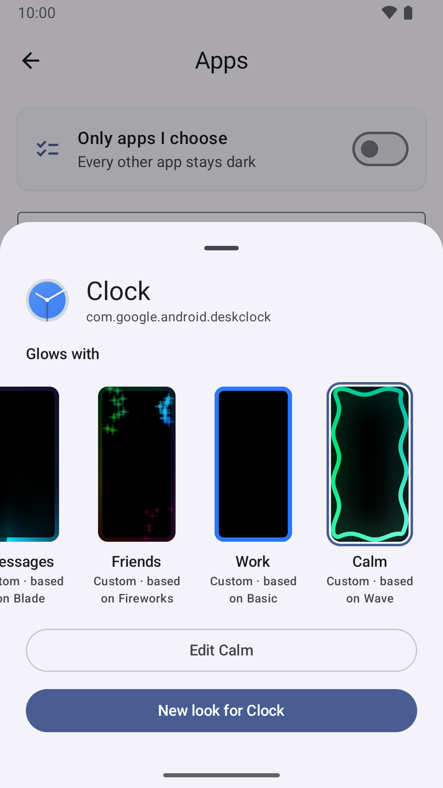
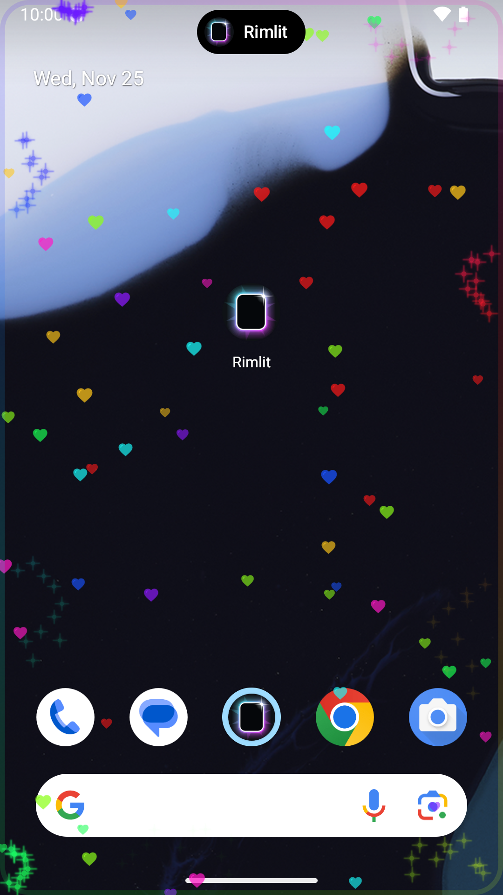
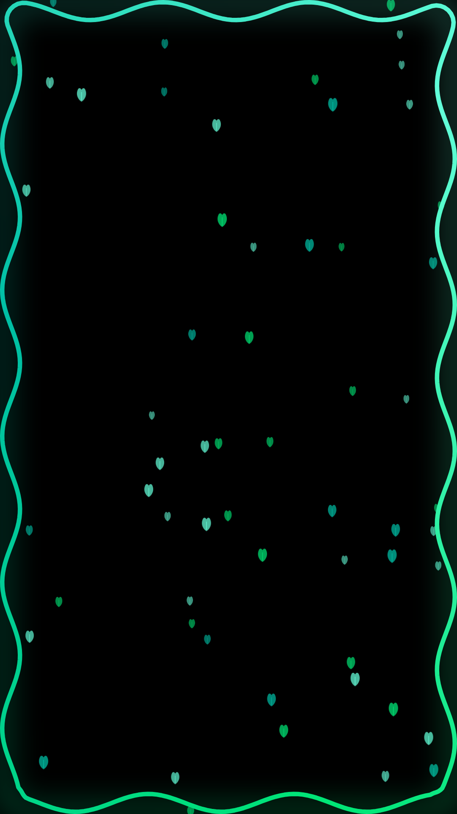

# Rimlit

Rimlit lights up the edges of your screen when a notification arrives — Samsung-style edge lighting for any Android phone. It is free, open source, has no ads, and never touches the network.

| Home | Look editor | Apps |
|---|---|---|
|  |  |  |

| An app's look | On screen | Screen off |
|---|---|---|
|  |  |  |

## Features

- **Works everywhere:** while you use the phone the glow is drawn over whatever is on screen; when the screen is off it wakes into a black, always-on-display style glow. With the recommended accessibility glow it also frames the lock screen itself.
- **Ten styles:** a crisp breathing edge, a soft bloom with a bright core, a blade of light racing around the screen, a wave rippling along it, glitter twinkling in your colors, rings echoing off it, two blades chasing each other round it, two blades rising up both sides to meet at the top, a blade sweeping round it and back like a boomerang, or fireworks bursting along it.
- **Particles:** snow, petals, rain, hearts, bubbles, confetti, stars or sparks across the screen while it glows, in the glow's colors or their own, with their size, speed, amount and spin to tune. Or use up to five of your own pictures, or the icon of the app that notified. Show them with any style, or on their own with no edge at all.
- **Your colors:** one to three colors picked automatically from the notifying app's icon (or from the notification's picture, such as the sender's photo), a single custom color (drag its Hue slider, or tap the color code beside it and type one, such as `#00BCD4`, with or without the `#`), a gradient of up to five colors, or a flowing rainbow.
- **Tune it:** thickness, glow width, speed, brightness (with its own setting for the screen-off glow if you like) and duration, down to a quick 0.3 s flash (in 0.1 s steps below one second), with a live preview that updates as you drag.
- **Looks:** start from a premade, one for each style, and save up to twenty named looks, each with its own style, colors, glow area, tuning and particles. A look is edited full screen, glowing round your screen's real edge over your wallpaper; whatever you change from its premade is marked, and can be reset one part at a time. Make any look the default for every app, or give an app a look of its own, from the look's Apps tab or from the app's side. Duration, corners, the camera cutout's shape, screen-off brightness and battery saver are shared by every look.
- **Share looks:** export all your looks, or the ones you pick, with their pictures, to a `.rimlit` file, or send it straight to someone through the share sheet. Importing one adds its looks to yours (a name you already use gets a number), and if they don't all fit you pick which to keep; your own looks and app choices are never replaced. Only looks are shared: no app list, quiet hours or device settings.
- **Easy on you and the battery:** with Remove animations turned on, the glow holds still instead of pulsing or racing; with battery saver (the system's, or always) it draws at most 30 frames a second.
- **Fits your screen:** follows your display's real rounded corners, and can ring the camera cutout instead of the whole edge, or as well as it. Under **Screen sides** in a look's Base tab (with **Tinker** on), choose which of the top, bottom, left and right sides glow; a lit side fades out smoothly into the corner of a side that is off, and particles still cover the whole screen.
- **When it glows:** choose separately whether it glows with the screen off, above the lock screen, and while you use the phone, and set daily quiet hours (for every glow, or only the one that wakes the screen). Turning edge lighting off, or switching an app off, also ends a glow that is showing.
- **Double tap to open:** double tap the screen-off glow to unlock and open the notification, just as tapping it in the shade would; a single tap still dismisses the glow. It can be turned off.
- **App pill:** while you use the phone, the glow comes with a small pill showing the app's icon and name (never the message), grown out of the camera like an island. Double tap it to open the notification (above the lock screen, after you unlock), or swipe it up or sideways to dismiss the glow, and optionally the notification too. Above a locked screen, a notification you hide from the lock screen glows without its pill and can't be cleared, so nothing there says which app it came from. The pill can be turned off.
- **Respectful:** honors Do Not Disturb, skips silent and low-priority notifications, and never covers incoming-call or alarm screens. Every app glows except those you switch off, or, if you prefer, only the apps you choose.

## Different looks for different apps

Every app glows with your default look unless you give it one of its own. There are two ways to do that, and they change the same thing.

**From the Apps screen** (Home, then **Settings**, then **Apps**):

1. Find the app, using the **Search apps** box or the **All** and **Own look** chips (the third chip, **Off**, shows the apps you switched off).
2. Tap the app. Its sheet shows every look as a tile under **Glows with**; tap one to use it. An app with no look of its own shows **Default** and the name of the default look.
3. For a look made just for the app, tap **New look for** the app and pick a premade to start from; the editor opens, and saving it gives the app that look. To change the look it already uses, tap **Edit** with the look's name (it says when other apps share the look, since editing it changes them too).
4. Use the switch on each row to turn an app off. With **Only apps I choose** on, only the apps switched on glow and every other app stays dark (the chip then reads **On**).

**From a look's own Apps tab** (tap a look on Home to open it in the editor, then the **Apps** tab):

1. Tick the apps that should use this look. The **Search apps** box finds one by name.
2. Turn on **Default for all apps** to make this the look every app without one of its own glows with. The current default look's switch is fixed; to change the default, make another look the default.
3. An app that already has another look of its own shows **Uses** and that look's name instead of a tick; change it from the Apps screen.

Nothing in the editor is saved until you tap **Save**. On Home, each look's tile shows how many apps use it (or **Not used**); tap the count to see their names. Deleting a look sends its apps back to the default look.

## Install

Rimlit needs Android 10 or newer. Download the latest APK from [Releases](https://github.com/adityam23/rimlit/releases) and open it on your phone (you may need to allow installs from your browser or file manager).

Open Rimlit and follow its setup, which walks you through the permissions below one step at a time, then checks the glow fits your screen (**Fit your screen**), lets you place the app pill (**The app pill**), pick a first look and try it, and turns **Edge lighting** on when you finish. Only notification access is required; anything you skip is listed on the home screen under **Needs attention**, and setup can be run again from Behavior (**Run setup again**), which adds your pick as a new default look and keeps the old one. The home screen also has a **Preview** section: **Preview on-screen**, **Preview lock screen** and **Send test notification**.

- **Notification access** — to notice when notifications arrive. Rimlit only looks at which app posted it and its colors; nothing is stored or sent anywhere. On Android 13 and newer you may first need to tap **Allow restricted settings** in Rimlit's App info menu.
- **Display over other apps** — to draw the glow while you use the phone.
- **Notifications** — Rimlit wakes the screen with a silent notification of its own, so keep its notifications and its "Edge lighting" category on.
- **Full-screen notifications** — to wake the screen and show the glow when it is off.
- **Accessibility glow** (recommended) — an accessibility service, **Rimlit glow**, that draws the glow over your apps and above the lock screen. It only owns the glow window: it receives no accessibility events and cannot read or control anything on screen. On Android 13 and newer you may first need to tap **Allow restricted settings** in Rimlit's App info menu.
- **Unrestricted battery** (recommended) — so the system doesn't delay the glow. Some phones (Xiaomi, Huawei, OnePlus) also need autostart enabled in their own battery settings.

### Why does Android say "Rimlit is displaying over other apps"?

Without the accessibility glow, Rimlit draws on-screen glows with **Display over other apps**, and Android posts that notice for as long as such a window is up. Turning on **Rimlit glow** in Accessibility settings avoids it: the glow is then drawn in an accessibility window, which Android doesn't announce. The home screen tells you when the notice will appear, including when the service is turned on but isn't running (turn it off and on again). On recent Android versions the notice itself can't be turned off; it is already a silent, minimised notification.

## Privacy

Rimlit has no internet permission at all, so it cannot send anything off your device. There are no analytics, ads or accounts. Settings stay on the phone and are excluded from cloud backups. Pictures you pick for particles come through the system photo picker (no storage permission), and Rimlit keeps only a small re-drawn copy of each, without the original file, its name or its metadata, deleted once no look uses it and it is at least a day old.

## Build from source

You need JDK 25, Gradle 9.8 and the Android SDK (platform 36). The project intentionally has no Gradle wrapper, so use your installed `gradle`:

```bash
gradle :app:testDebugUnitTest :app:assembleDebug :app:lintDebug :app:detektMain
adb install -r app/build/outputs/apk/debug/app-debug.apk
```

## Releases

Grab signed APKs from [GitHub Releases](https://github.com/adityam23/rimlit/releases).

## License

Rimlit is licensed under the [GNU General Public License v3.0](LICENSE).
